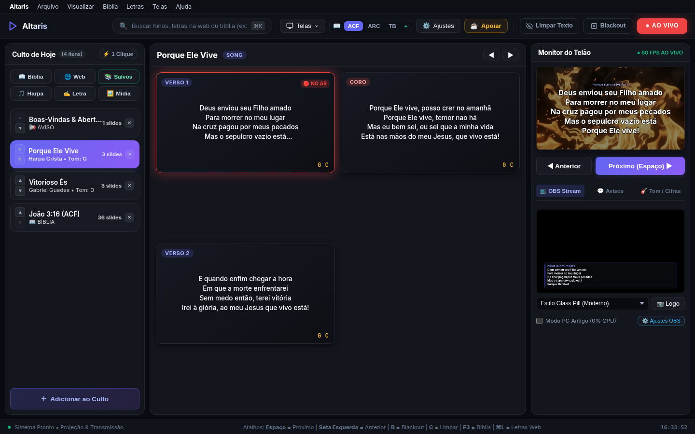

<div align="center">

# ⛪ Altaris Presenter

### Sistema Profissional de Projeção, Retorno de Palco e Transmissão para Igrejas

[](https://github.com/JonathasHenrique/altaris-presenter/releases)
[](LICENSE)
[](#-download-r%C3%A1pido)
[](#)

[](https://tauri.app)
[](https://www.rust-lang.org)
[](https://www.typescriptlang.org)
[](https://vitejs.dev)

[](https://link.mercadopago.com.br/johntechdicas)
[](https://www.youtube.com/@johntechdicas)

<br/>

**O software livre mais rápido, moderno e confiável para projeção multimídia e transmissão de cultos.**  
Zero travamentos, consumo de memória inferior a 50MB de RAM e controle total a partir do computador ou smartphone.

<br/>



</div>

<br/>

---

## 📥 Download Rápido

| Sistema Operacional | Formato | Arquitetura | Link de Download |
| :--- | :--- | :--- | :--- |
| **Linux (Ubuntu, Debian, Mint)** | `.deb` | x86_64 | [Baixar v1.0.0 (.deb)](https://github.com/JonathasHenrique/altaris-presenter/releases/latest) |
| **Linux (Universal)** | `.AppImage` | x86_64 | [Baixar v1.0.0 (.AppImage)](https://github.com/JonathasHenrique/altaris-presenter/releases/latest) |
| **Linux (Fedora, RHEL)** | `.rpm` | x86_64 | [Baixar v1.0.0 (.rpm)](https://github.com/JonathasHenrique/altaris-presenter/releases/latest) |
| **Windows** | Instalador `.msi` / `.exe` | 64-bit | [Baixar v1.0.0 (.exe)](https://github.com/JonathasHenrique/altaris-presenter/releases/latest) |

> 📖 **Quer ver o passo a passo completo com telas e detalhes de cada recurso?**  
> Acesse o nosso [📖 Manual e Apresentação Visual do Sistema (docs/APRESENTACAO_APP.md)](docs/APRESENTACAO_APP.md).

---

## 💡 Por que o Altaris Presenter?

Diferente de softwares de projeção pesados, caros ou que travam durante os cultos, o **Altaris Presenter** foi projetado do zero com uma arquitetura moderna e eficiente:

- 🚀 **Desempenho Nativo em Rust & Tauri v2**: Inicia em milissegundos e consome menos de **50MB de RAM** (ao contrário de soluções pesadas em Electron ou Java).
- 🎨 **Interface Inspirada no macOS**: Visual limpo, escuro, refinado e com foco total na usabilidade do operador voluntário.
- 🛡️ **Engatilhamento em 2 Cliques**: Evite projetar slides errados acidentalmente. O 1º clique seleciona em amarelo para conferência e o 2º projeta ao vivo.
- 📱 **Controle Remoto PWA**: Qualquer celular ou tablet na mesma rede Wi-Fi vira um controle remoto sem precisar instalar nenhum aplicativo.
- 📺 **Multi-Saídas Simultâneas**: Telão do Público (16:9 4K), Retorno de Palco com Cifras e Overlay Transparente para OBS Studio / vMix.
- 📦 **100% Offline & Backup Portável**: Funciona perfeitamente sem internet e permite salvar e restaurar todo o sistema com um clique (`.altaris-backup.json`).

---

## 🌟 Módulos e Recursos

### 🖥️ 1. Centro de Controle do Operador
Painel central completo com visualizador de slides em grade, monitor de telão em tempo real a 60 FPS, busca rápida global (⌘K), biblioteca de louvores, bíblias e controle instantâneo de emergência (`C` para Limpar Texto e `B` para Blackout).

### 🎬 2. Telão do Público (16:9 / 4K)
Saída de vídeo com aceleração gráfica WebGL e Canvas virtual, suporte a fundos dinâmicos em loop (shaders e vídeos MP4/WebM), auto-fit automático de texto e efeitos de sombra de alto contraste para leitura em qualquer iluminação.

### 🎸 3. Retorno de Palco (Stage Display com Cifras)
Tela dedicada para ministros e banda musical, exibindo cifras em destaque alinhadas às sílabas da música, relógio litúrgico em tempo real, prévia da próxima estrofe e avisos emergenciais do operador.

### 🎥 4. Transmissão para OBS Studio & vMix
Overlay lower-third 100% transparente com canal alfa (`stream.html`), temas modernos como *Glass Pill* e editor integrado de CSS/HTML ao vivo para personalização das cores e formato da transmissão.

### 📱 5. Controle Remoto PWA no Celular
Acesse o controle do culto de qualquer smartphone (Android ou iPhone) escaneando um QR Code. Permite avançar hinos, navegar na Bíblia e disparar avisos diretamente do púlpito ou de qualquer lugar do auditório.

### 📖 6. Navegador Bíblico Visual de 1 Clique
Grade interativa com separação canônica dos 66 livros da Bíblia (39 Antigo Testamento / 27 Novo Testamento), seleção de capítulos e versículos instantânea e leitura contínua de capítulos inteiros.

### 🎼 7. Harpa Cristã e Hinários Completos
Todos os hinos clássicos com letras estruturadas e busca inteligente por número ou palavras da letra.

### 🎲 8. Sorteios e Dinâmicas de Grupo
Roleta digital animada integrada para eventos de jovens, conferências, aniversariantes do mês e sorteio de brindes na congregação.

### 💾 9. Sistema de Backup e Roteiro de Culto
Exporte ou importe tudo (músicas offline, temas visuais, estilos do OBS, bíblias e preferências) em um único arquivo `.altaris-backup.json`, ou compartilhe apenas a sequência do culto do dia com arquivos `.opw.json`.

---

## ⌨️ Atalhos de Teclado (Cheat Sheet)

| Tecla | Ação |
| :--- | :--- |
| `Espaço` / `Seta Direita` | Avançar para o próximo slide |
| `Seta Esquerda` / `Backspace` | Voltar para o slide anterior |
| `B` | Alternar modo **Blackout** (tela preta imediata) |
| `C` | Alternar modo **Limpar Texto** (mantém o fundo e apaga a letra) |
| `F3` | Abrir Navegador Bíblico Visual |
| `⌘K` ou `Ctrl+K` | Barra de Busca Global (Bíblia, Louvores e Harpa) |
| `F5` | Abrir/Fechar Telão do Público |
| `F6` | Abrir/Fechar Retorno de Palco |

---

## 🛠️ Tecnologias Utilizadas

- **Framework Nativo**: [Tauri v2](https://tauri.app/) (Rust)
- **Linguagem Backend**: [Rust](https://www.rust-lang.org/)
- **Frontend**: [TypeScript](https://www.typescriptlang.org/) + HTML5 / Modern CSS
- **Bundler & Dev Server**: [Vite 5](https://vitejs.dev/)
- **Motor de Renderização**: Canvas 2D Virtual / WebGL Shader Pipeline
- **Comunicação em Tempo Real**: WebSocket & Local Broadcast Channel

---

## 💻 Como Executar e Compilar Localmente

### Pré-requisitos:
- **Node.js**: versão 18 ou superior
- **Rust & Cargo**: versão estável mais recente
- **Dependências Linux (Debian/Ubuntu)**:
  ```bash
  sudo apt install libwebkit2gtk-4.1-dev build-essential curl wget file libssl-dev libgtk-3-dev libayatana-appindicator3-dev librsvg2-dev
  ```

### Executando em Modo de Desenvolvimento:
```bash
# 1. Clone o repositório
git clone https://github.com/JonathasHenrique/altaris-presenter.git
cd altaris-presenter

# 2. Instale as dependências do frontend
npm install

# 3. Inicie o aplicativo em modo de desenvolvimento
npm run tauri dev
```

### Gerando o Executável de Produção:
```bash
npm run tauri build
```
Os instaladores gerados estarão localizados em `src-tauri/target/release/bundle/`.

---

## ☕ Apoie o Projeto

O **Altaris Presenter** é e sempre será 100% gratuito e de código aberto para abençoar as igrejas e comunidades locais. Se este projeto ajuda o seu ministério, considere apoiar a manutenção e o desenvolvimento contínuo!

<div align="center">

[](https://link.mercadopago.com.br/johntechdicas)

**Link direto para doação**: [https://link.mercadopago.com.br/johntechdicas](https://link.mercadopago.com.br/johntechdicas)

Inscreva-se também no nosso canal no YouTube:  
[](https://www.youtube.com/@johntechdicas)

</div>

---

## ⚖️ Isenção de Responsabilidade e Marcas Registradas

O **Altaris Presenter** é um software independente desenvolvido pela comunidade sob os termos da licença **GNU General Public License v3.0 (GPLv3)**.

Todas as marcas registradas, nomes de produtos, logotipos e extensões de arquivo citados neste projeto (como *ProPresenter® / Renewed Vision*, *Holyrics®*, *OpenLP®*, *EasyWorship®*, *OBS Studio®*, etc.) são de propriedade exclusiva de seus respectivos proprietários. A menção a estes nomes destina-se unicamente à documentação de **interoperabilidade e compatibilidade de formatos de arquivo**, de acordo com a legislação de propriedade intelectual e direito de interoperabilidade.

---

## 📄 Licença

Este projeto é licenciado sob a **GNU General Public License v3.0 (GPLv3)**.  
Consulte o arquivo [LICENSE](LICENSE) para mais informações.
