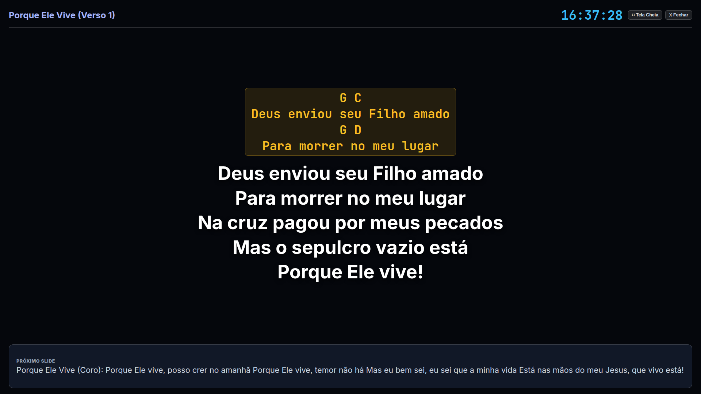
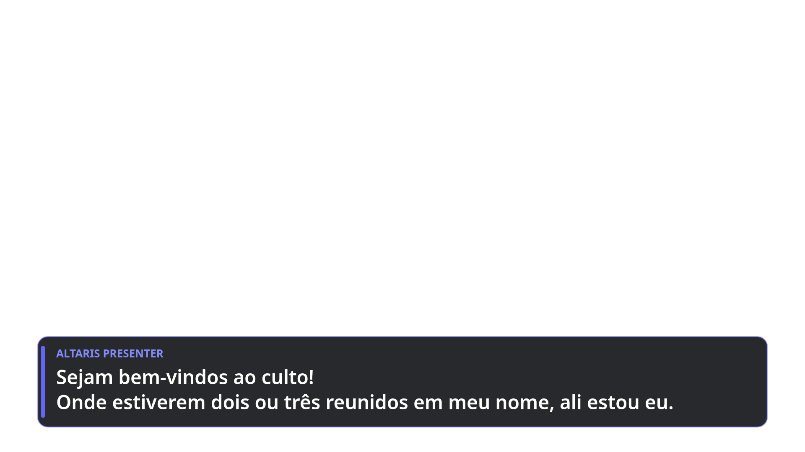
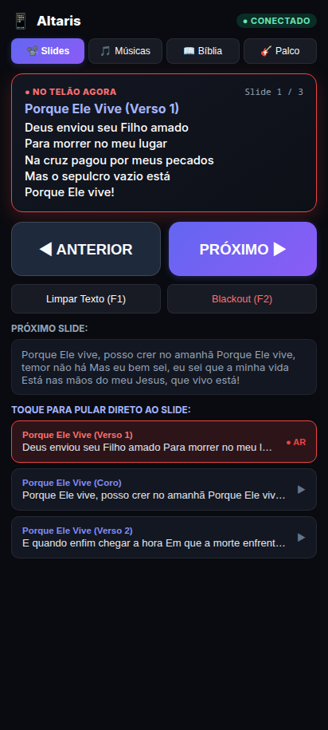
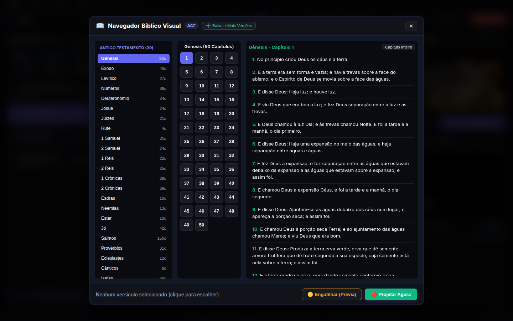
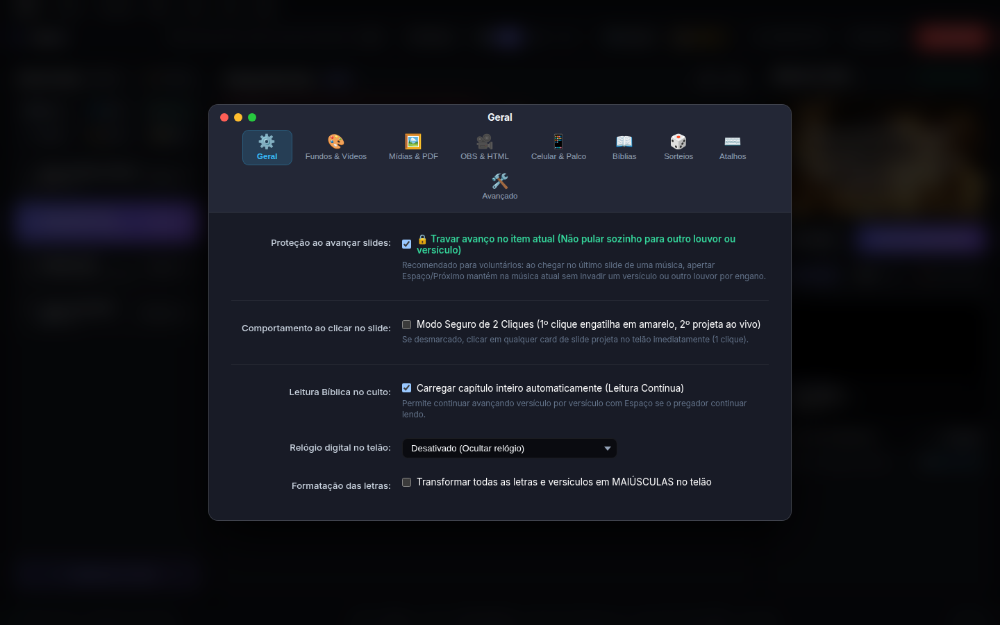
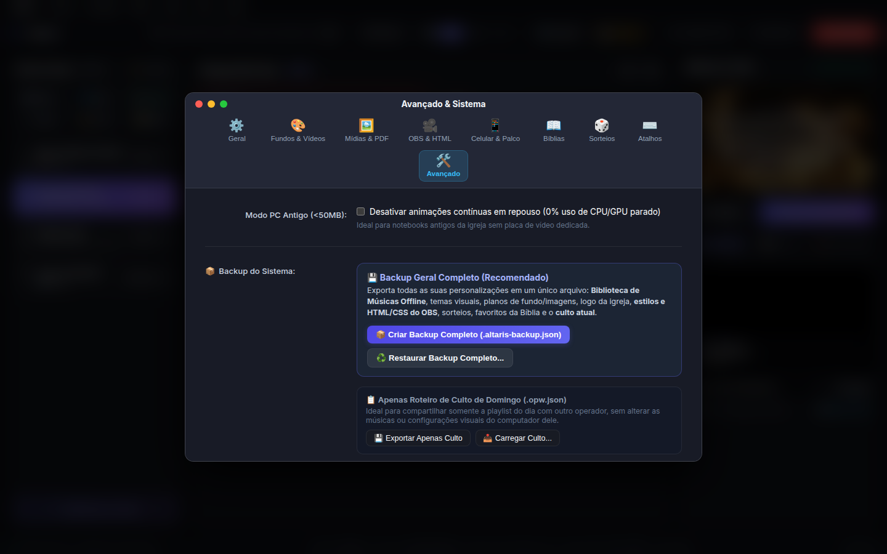

# 🖥️ Altaris Presenter — Manual e Apresentação Visual do Sistema

Bem-vindo ao guia visual do **Altaris Presenter**, o software livre, moderno e ultra-leve de projeção e transmissão para igrejas, auditórios e eventos.

---

## 📑 Índice Visual

1. [Centro de Controle do Operador (Painel Principal)](#1-centro-de-controle-do-operador)
2. [Telão do Público (Projeção 16:9 / 4K)](#2-telão-do-público-projeção-169)
3. [Retorno de Palco para Músicos e Ministros](#3-retorno-de-palco-stage-display)
4. [Transmissão ao Vivo para OBS Studio & vMix](#4-transmissão-ao-vivo-obs-studio--vmix)
5. [Controle Remoto PWA para Celular e Tablet](#5-controle-remoto-pwa-para-celular)
6. [Navegador Bíblico Visual de 1 Clique](#6-navegador-bíblico-visual)
7. [Painel de Ajustes e Personalização macOS-Style](#7-painel-de-ajustes-e-personalização)
8. [Sistema de Backup e Roteiros de Culto](#8-sistema-de-backup-e-roteiros-de-culto)

---

## 1. Centro de Controle do Operador

O centro nevrálgico do operador foi desenhado seguindo a filosofia de design da Apple (macOS), com interface escura de altíssimo contraste, visualização em tempo real a 60 FPS e fluxo de engatilhamento seguro contra erros operacionais.

### Principais Destaques:
- **Fluxo de 2 Cliques (Prevenção de Erros)**: O 1º clique seleciona/engatilha o slide em amarelo (para conferência do voluntário); o 2º clique projeta ao vivo no telão. Também configurável para 1 clique direto.
- **Playlist do Culto (Arrastar e Soltar)**: Alterne rapidamente entre momentos de boas-vindas, blocos de louvor, leitura da palavra e avisos gerais.
- **Monitor do Telão ao Vivo**: Visualize exatamente o que está sendo exibido para a congregação, incluindo fundos animados e textos formatados.
- **Barra de Atalhos Globais**: Controle total por teclado (`Espaço` para próximo, `Seta Esquerda` para anterior, `B` para Blackout e `C` para Limpar Texto).

---

## 2. Telão do Público (Projeção 16:9)

A saída para o projetor ou painel de LED é renderizada via WebGL e Canvas virtual em 1920x1080 com escalonamento automático (auto-fit), garantindo que as letras nunca fiquem cortadas.

### Recursos de Projeção:
- **Fundos Dinâmicos**: Suporte a shaders animados (Nebula, Partículas, Estrelas), vídeos em loop (MP4/WebM) ou imagens estáticas.
- **Tipografia Fluida**: Sombras projetadas de alto contraste (*Drop Shadow*) e traçado de contorno (*Text Stroke*) para leitura perfeita mesmo em ambientes claros.
- **Transições Suaves**: Crossfade de fade-in e fade-out sem saltos visuais.

---

## 3. Retorno de Palco (Stage Display)

Desenvolvido para músicos, cantores e pregadores. Fornece uma visualização limpa, de altíssimo contraste e sem distrações visuais.

### Recursos para a Equipe de Louvor:
- **Cifras Alinhadas ao Vivo**: As cifras musicais aparecem em destaque amarelo exatamente sobre as sílabas correspondentes do verso.
- **Prévia do Próximo Slide**: Saiba com antecedência a próxima estrofe ou coro antes da troca acontecer.
- **Relógio de Palco**: Marcador de horário em tempo real para controle da liturgia do culto.
- **Alertas do Pastor/Técnico**: Receba avisos emergenciais diretamente no monitor de retorno.

---

## 4. Transmissão ao Vivo (OBS Studio & vMix)

Envie as letras e versículos bíblicos diretamente para a sua transmissão online com fundo 100% transparente via Browser Source no OBS Studio, vMix ou Wirecast.

### Integração com Transmissão:
- **URL Local dedicada**: `http://localhost:5173/stream.html` (ou porta de rede interna).
- **Temas Nativos**: Escolha entre Glass Pill (Moderno), Barra Inferior Clássica ou crie seu próprio CSS/HTML personalizado.
- **Sincronia Instantânea**: Latência menor que 2 milissegundos via WebSocket local.

---

## 5. Controle Remoto PWA para Celular

Não fique preso à mesa de som ou ao computador! Controle todo o culto da palma da mão através do navegador de qualquer smartphone Android ou iPhone (iOS).

  

### Vantagens do Remoto:
- **Sem Instalação**: Basta escanear o QR Code gerado na tela de ajustes e abrir no navegador do celular.
- **Navegação Rápida**: Botões gigantes de *Anterior* e *Próximo*, além dos comandos de emergência *Limpar Texto* e *Blackout*.
- **Pulo Direto**: Toque em qualquer slide da lista para ir diretamente para o Coro ou Ponte da música.

---

## 6. Navegador Bíblico Visual

Localize qualquer passagem das Escrituras Sagradas em segundos com a grade visual interativa.

### Recursos Bíblicos:
- **Divisão Canônica**: Separação clara entre Antigo Testamento (39 livros) e Novo Testamento (27 livros).
- **Traduções Bíblicas Gratuitas**: Suporte a múltiplas versões offline (ACF, ARC, TB e outras).
- **Leitura Contínua**: Projete versículo a versículo ou carregue o capítulo inteiro para acompanhamento dinâmico do pregador.

---

## 7. Painel de Ajustes e Personalização

Um painel de preferências moderno e intuitivo estilo macOS, agrupando todas as ferramentas do sistema de forma limpa e organizada.

### Abas de Ajustes:
- **Geral**: Travamento de avanço acidental de músicas, modo de 2 cliques e relógio no telão.
- **Fundos & Vídeos**: Gerenciamento de motion loops e banco de imagens.
- **Mídias & PDF**: Projeção de avisos em imagem e apresentações em PDF.
- **OBS & HTML**: Editor de CSS/HTML ao vivo para o lower-third da transmissão.
- **Celular & Palco**: Configurações de rede e QR Code do controle remoto.
- **Bíblias**: Download e alternância de versões bíblicas.
- **Sorteios**: Roleta visual de sorteios para dinâmicas e aniversariantes.
- **Atalhos**: Referência e configuração de atalhos de teclado.
- **Avançado**: Modo PC Antigo (<50MB RAM) e backup do sistema.

---

## 8. Sistema de Backup e Roteiros de Culto

Proteja todo o trabalho da sua equipe com um sistema robusto de cópia de segurança em formato aberto JSON.

### Opções de Backup:
- **Backup Geral Completo (`.altaris-backup.json`)**: Salva toda a biblioteca de músicas offline, temas visuais, planos de fundo, logomarca da igreja, estilos do OBS, sorteios e o culto atual.
- **Roteiro do Culto de Domingo (`.opw.json`)**: Exporta apenas a playlist e a sequência do culto para compartilhar rapidamente com outro computador ou operador.

